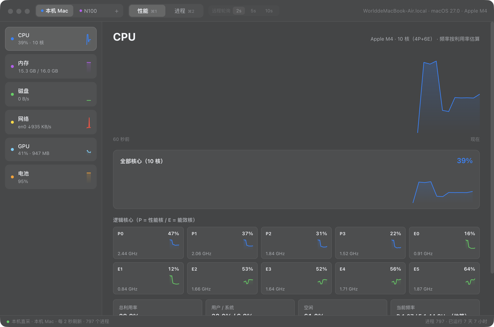
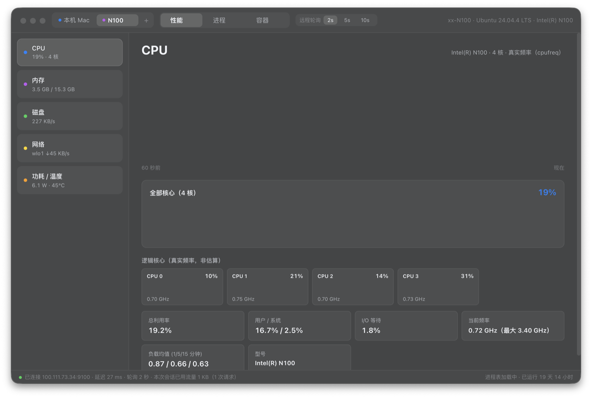
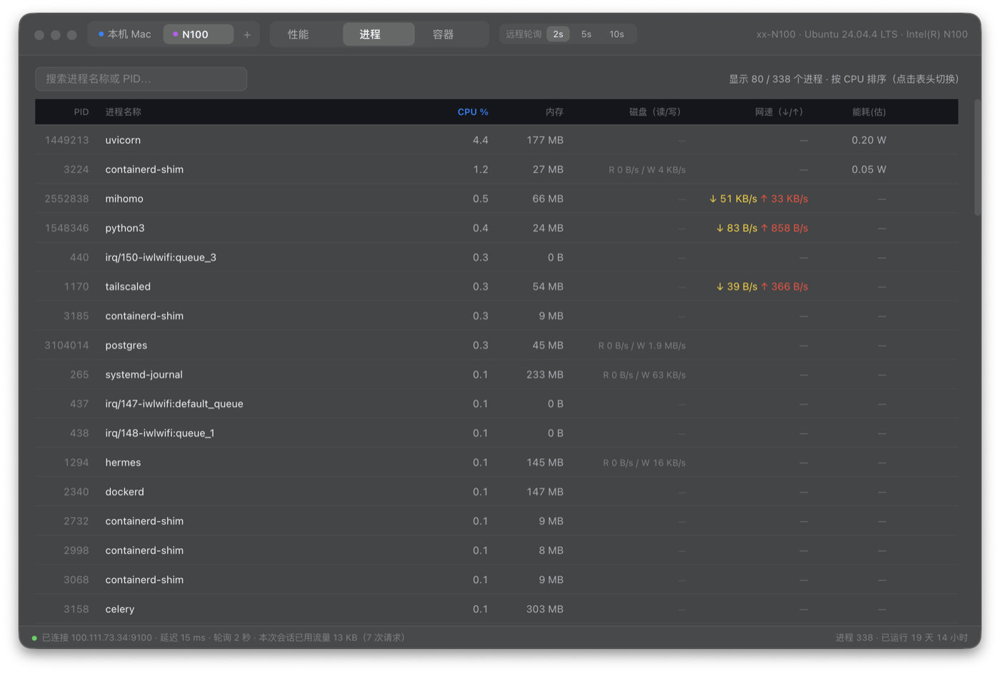
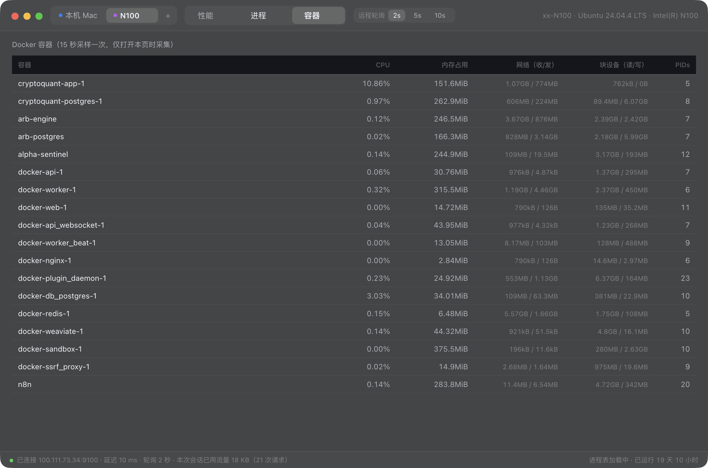

# 任务管理器-统一版

一个 macOS App，同时监控**本机 Mac、远程 Linux（N100 等）、Windows 11**——整合自 [mac-task-manager](https://github.com/zsan189312-sys/mac-task-manager)（本机版）与 [mac-task-manager-n100](https://github.com/zsan189312-sys/mac-task-manager-n100)（远程版），两个原项目保持独立可用。

## 下载（免编译）

👉 [Releases 页 → v2.2.7](https://github.com/zsan189312-sys/mac-task-manager-unified/releases/tag/v2.2.7)

下载 `TaskManager-Unified-v2.2.7-macOS-arm64.zip`（约 100 MiB，Apple Silicon / M 系列），解压后把「任务管理器-统一版.app」拖进「应用程序」，**首次打开需右键 → 打开**（未做 Apple 公证，右键打开一次后即可正常双击）。

各版本 ZIP 的 SHA256 见对应 Release 说明。

## Android 手机端

独立原生 Android 16 客户端 **三端任务管理器 1.0.3**：三台卡片总览、真实采样动效、详细指标与只读进程列表。[源码与部署说明](mobile/README.md) · [APK 预览版下载](https://github.com/zsan189312-sys/mac-task-manager-unified/releases/tag/android-v1.0.3)。已在 Android 16 真机通过 Tailscale 验证 Mac/N100；Win11 因设备无法开机仍待导出器部署与联调，详见交付边界。

## 预览

| 本机 Mac（性能页） | 远程 N100（性能页） |
|---|---|
|  |  |

左：P/E 核分离十核图块、内存、磁盘、网络、GPU、电池。右：4 核真实频率、RAPL 实时功耗与温度。

## 特性

**三类数据源，一键切换**（顶栏主机切换器，支持添加/移除多台远程主机）：

| | 本机 Mac | 远程 Linux（N100 等） | Windows 11 |
|---|---|---|---|
| 采集方式 | Swift 助手 + 系统命令直采 | agent（HTTP + gzip） | SSH + PowerShell WMI，无 TMU agent |
| 刷新 | 固定 2 秒 | 2s / 5s / 10s 可调 | 同左；实际更新受单轮采集耗时限制 |
| CPU | 每核占用 + P/E 核分组 + 估算频率 | 每核占用 + cpufreq | 逐逻辑核动态 perf 频率，优先有效 LHM Clock |
| 独有面板 | GPU（IOAccelerator）、电池 | RAPL 功耗、温度、Docker | NVIDIA GPU、LHM 可用分项、文件浏览/上传/下载 |

**进程页**（统一七列）：CPU（占整机 %）、内存、磁盘读/写、网速 ↓/↑、能耗瓦数、远程/本地结束进程。macOS 侧已适配 macOS 27 的坑：KERN_PROC_ALL 全量枚举 + darwinbg/nice 线程 CPU 归属修复（kernel_task 与受保护系统进程聚合补齐）。



**容器页**（远程主机）：Docker 容器 CPU / 内存 / 网络 / 块设备 / PIDs，仅在打开本页时采样。



**低占用设计**：窗口最小化、隐藏、锁屏或睡眠时停采；恢复后立即刷新，暂停期间的曲线留断点。正常显示时 Mac 继续每 2 秒采样，远程按所选间隔轮询；单轮未完成时不叠加追赶任务。进程表、容器和 Mac 逐进程网络仅在相应页面采集。图表使用软件绘制，减少图形缓存；并非持续动画。

v2.2.6 实测：Mac 6 轮非进程页采集命令 59→47；Win11 每轮有效载荷约 33 KB→4.2 KB（不含 SSH 协议开销）。Win11 传感器收到请求才访问 CPU 驱动，无请求时阻塞等待；GPU 仅由 nvidia-smi 读取。数值为当次环境测试，实际资源随页面、进程数量和系统负载变化。

## Windows 与断线恢复

Windows 使用现有 SSH 别名 `win11`，SFTP 盘符绝对路径为 `/C:/...`。动态 CPU 频率每轮读取 PercentProcessorPerformance × 标称 MHz / 100；GPU 用 nvidia-smi，温度/功耗接入 LHM 0.9.6 + PawnIO 2.2.0 服务（[部署说明](windows/README.md)）。传感器任务当前在用户登录后启动；未登录、驱动读数无效时如实显示缺失。

断线时显示自动重试遮罩并暂停追加旧指标；SSH 可达后自动恢复，重启/断线后重新建立进程 CPU 差分基准。文件页支持右键复制、剪切、重命名、新建、回收站删除；同名目标拒绝静默覆盖。删除只送 Windows 回收站。

## 开发测试

```sh
node tests/regression.cjs
node --check app/main.js
node --check app/renderer.js
```

测试在隔离 VM 中执行实际主进程/渲染逻辑，并使用短时本机 HTTP 服务测试异常响应；不会连接真实远程机或结束进程。真实机器测试记录另见对应版本交付报告。

## 构建

```bash
cd app && ./build.sh   # 历史完整构建脚本；日常更新请遵守下方部署约定
```

## 远程主机部署

在目标 Linux 机上部署 agent（Python 标准库零依赖，详见 [mac-task-manager-n100](https://github.com/zsan189312-sys/mac-task-manager-n100)）：

```bash
scp agent/n100_agent.py root@目标机:/opt/n100-agent/
scp agent/n100-agent.service root@目标机:/etc/systemd/system/
ssh root@目标机 "systemctl daemon-reload && systemctl enable --now n100-agent"
```

agent 默认绑定 `0.0.0.0:9100`（建议防火墙限制来源），root 运行以读取 RAPL 功耗与全部进程磁盘 I/O。App 顶栏「+」填入 IP 与端口即可接入。

## 结构

```
app/
  main.js         # 主进程：本机采集 + 远程 HTTP 双数据源、多主机管理、轮询
  renderer.js     # 统一渲染：动态卡片（GPU/电池/功耗按可用性显示）
  index.html      # macOS 毛玻璃 UI、主机切换器
  preload.js      # contextBridge
  cpucores.swift  # Mach API 每核 CPU tick（macOS 27 移除了 kern.cp_time）
  procinfo.swift  # KERN_PROC_ALL + PROC_PIDTASKINFO/rusage 进程采集
  icon.swift      # 程序化图标（紫蓝配色 + 双机指示点）
  build.sh        # 一键构建
agent/            # 指向 mac-task-manager-n100 的部署脚本（同源）
```

## 已知口径说明

- 本机 CPU 频率为估算（Apple Silicon 无用户态频率接口）：`基础频率 + 利用率 × (睿频 − 基础)`，P 核 ≤ 4.41 GHz / E 核 ~2.6 GHz
- 本机磁盘吞吐 macOS iostat 不区分读/写，显示为合计；远程主机为真实读/写差分
- 能耗：本机 = 整机份额 × 20W 估算；远程 = 真实 RAPL 封装功耗 × CPU 份额

## 本机部署约定

用户现有部署必须使用全绝对路径 rsync，再 ad-hoc 签名；禁止依赖 cwd 与临时路径变量。更新后用 Electron 可执行文件启动，不能使用 `open`（此环境会静默失败）。版本、状态栏与 CHANGELOG 一起更新；正式发布流程见 iCloud 项目档案。不要用历史 build.sh 的安装/启动步骤代替已确认的部署模板。
